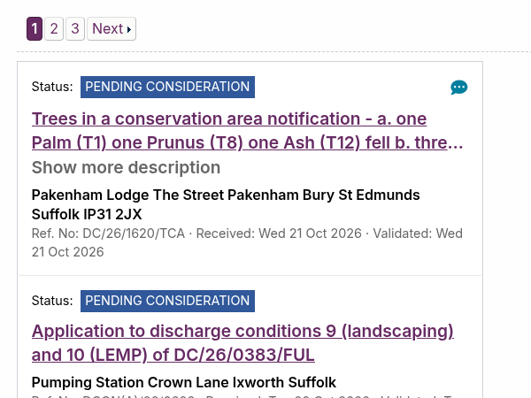
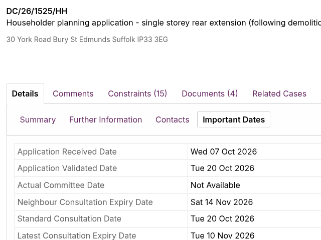
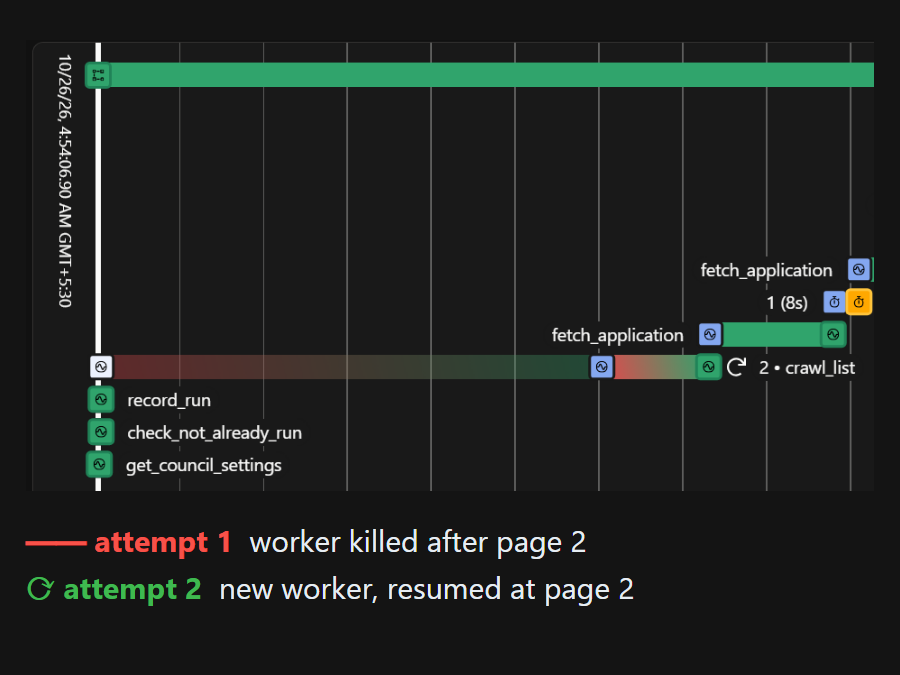
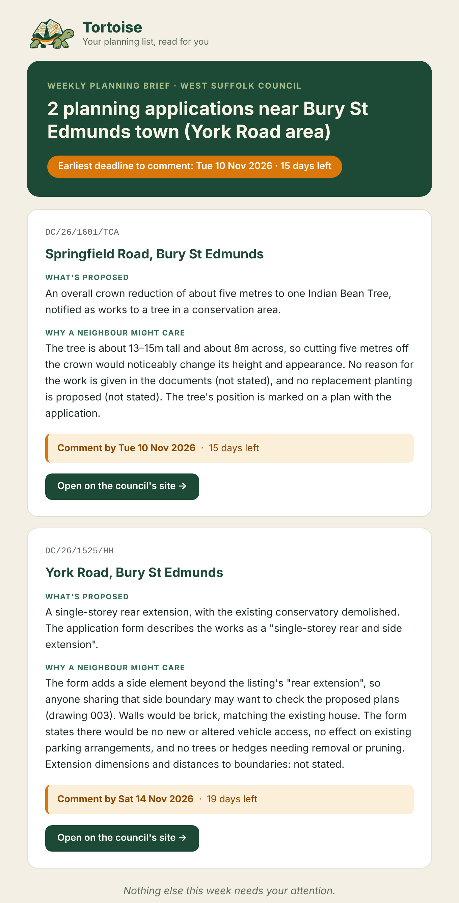
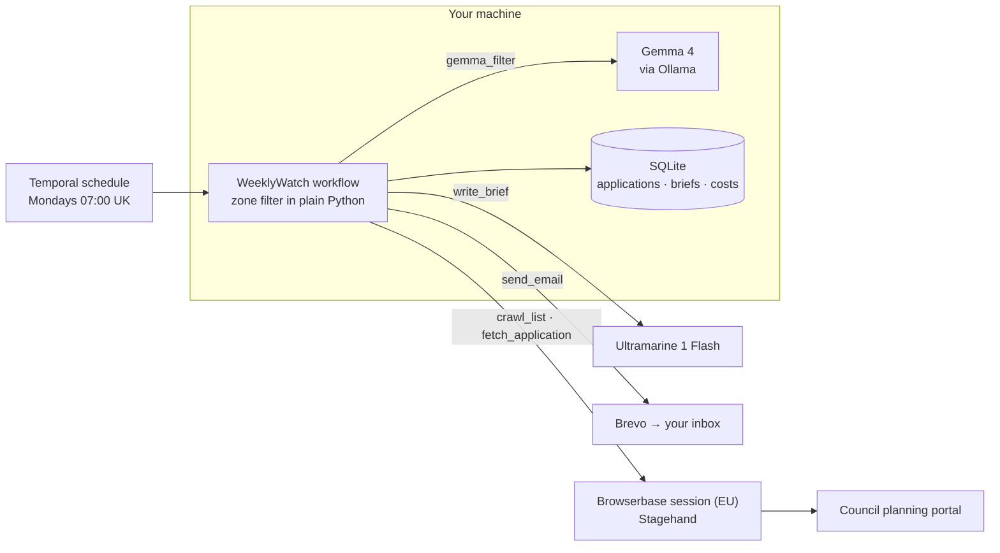

<p align="center">
  <picture>
    <source media="(prefers-color-scheme: dark)" srcset="assets/wordmark-dark.png">
    
  </picture>
</p>

<h3 align="center">Never open a 60-page planning PDF again.</h3>

<p align="center">
  A slow, steady agent that reads a UK council's weekly planning list and the PDFs behind it,<br>
  then emails you a one-page brief: what's being built near your street, and the date to object by.
</p>

<p align="center">
  <a href="https://github.com/CodeNeuron58/tortoise/actions/workflows/ci.yml"></a>
  
  
  <a href="https://dev.to/code_neuron58/tortoise-a-slow-agent-that-reads-your-councils-planning-applications-so-you-dont-have-to-5akk"></a>
</p>

## How it works

<table>
  <tr>
    <td width="33%" valign="top"></td>
    <td width="33%" valign="top"></td>
    <td width="33%" valign="top"></td>
  </tr>
  <tr>
    <td valign="top"><b>1 · Crawl</b><br>Every Monday, Stagehand reads the council's weekly list in a Browserbase session, one polite page at a time.</td>
    <td valign="top"><b>2 · Read</b><br>Only applications on your streets are opened: the comment deadline, and the text of up to three documents. Drawings are skipped.</td>
    <td valign="top"><b>3 · Never start over</b><br>Temporal runs the week. Kill it mid-crawl and it resumes from the last page it read.</td>
  </tr>
</table>

## What lands in your inbox

<p align="center">
  <br>
  <sub>A real week's email, house numbers removed</sub>
</p>

Gemma filters the applications locally, Ultramarine writes the brief, Brevo sends it. Deadlines and links come from the council's own pages, never from the model, and anything missing says "not stated".

## Built with

| Piece | What it does |
|---|---|
| **Stagehand + Browserbase** | Drives the council's planning site in an EU cloud browser, written for the Idox system 150+ UK councils share |
| **Temporal** | The Monday schedule; every step retries, and a crash resumes from the last page read |
| **Gemma 4** | Labels every in-zone application locally through Ollama, for free |
| **Ultramarine 1 Flash** | Reads the PDFs and writes the brief, every token counted |
| **pypdf · Brevo** | PDF text, skipping scans and drawings · the weekly email |

## Results

| One real week · West Suffolk · 2026-W44 | |
|---|:---:|
| Applications on the weekly list | 23 |
| In the watch zone | 2 |
| PDFs read for you | 2 |
| Comment deadlines found | 14 Nov · 10 Nov |
| Browser minutes | 1.7 |
| Cost for the whole week | **$0.0021** |

All six failure tests pass against the live stack: the worker killed mid-crawl, the browser session ended, Ultramarine failing, Ollama down, the same week run twice, and a slow council site. **[See the evidence →](docs/failure-tests.md)**

> Both example councils ship **disabled**: every Idox portal checked serves `robots.txt` with `Disallow: /`. Switch a council on only with its permission.

<details>
<summary><b>Run it locally</b></summary>

<br>

Python 3.11 with [uv](https://docs.astral.sh/uv/), the [Temporal CLI](https://docs.temporal.io/cli), [Ollama](https://ollama.com) with `gemma4:e4b`, and keys for Browserbase, Ultramarine and Brevo in `.env` (see [`.env.example`](.env.example)).

```bash
uv sync
cp .env.example .env
uv run tortoise config-check      # councils, zones, missing keys
```

Put your council and your streets in [`config/councils.toml`](config/councils.toml). One terminal each:

```bash
temporal server start-dev --db-filename data/temporal.db
uv run tortoise worker
uv run tortoise run-once --council <slug> --browserbase
```

Then `uv run tortoise schedule add --council <slug>` for every Monday at 07:00 UK time, `uv run tortoise runs` for the log, and `uv run tortoise email-preview --council <slug> --week <week>` to see any past email again without crawling.

</details>

<details>
<summary><b>How it fits together</b></summary>

<br>



| Folder | What's inside |
|---|---|
| [`src/tortoise/crawl/`](src/tortoise/crawl/) | Stagehand driver, Idox page parsers, document selection |
| [`src/tortoise/workflow/`](src/tortoise/workflow/) | The Temporal workflow, activities, schedule and worker |
| [`src/tortoise/`](src/tortoise/) | Zone filter, Gemma filter, brief, email, storage, cost |
| [`config/`](config/) | `councils.toml`: your council and watch zone |
| [`docs/`](docs/) | Failure tests, evidence, screenshots |

</details>

<details>
<summary><b>Politeness rules</b></summary>

<br>

- One page at a time, 5–10 seconds apart, with a durable 8-second pause between applications.
- Only last week's list, only applications in your zone, at most three documents each.
- Never logs in, comments or submits anything. Every browser session is released the moment its work is done.
- Never opens the tabs that carry applicants' names, and the brief is told never to name people.
- Nothing can start a run for a council with `enabled = false`.

</details>

<details>
<summary><b>Cost, counted to the token</b></summary>

<br>

```
cost = (0.15 × uncached input + 0.03 × cached input + 0.50 × output) / 1,000,000   USD
```

Every call is logged in the `costs` table ([export](docs/evidence/cost-log.csv)), and each email's footer carries the week's totals. The crawl uses direct selectors, so the browser-driving model is normally never called.

</details>

<details>
<summary><b>Tests</b></summary>

<br>

```bash
uv run pytest      # 110 offline tests: no network, no Ollama, no browser
```

The crawl runs against a scripted fake browser and the cost formula is pinned to hand-worked examples. The six live failure tests and their exported Temporal histories are in [docs/failure-tests.md](docs/failure-tests.md). CI runs the tests on every push.

</details>

---

<p align="center">
  <sub>MIT licensed · built for the <a href="https://dev.to/challenges/hacktoberfest-week3-2026-10-19">DEV Hacktoberfest Open-Source AI Challenge: Week 3, Slow and Steady</a></sub>
</p>
